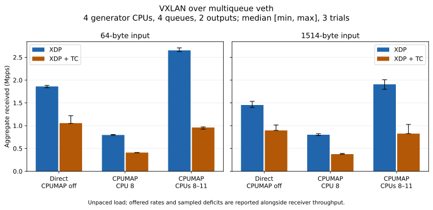

# Flow hashing across CPUMAP CPUs

This experiment compares VXLAN unicast replication with CPUMAP disabled, one forwarding CPU, and four forwarding CPUs.
All three matrices use the same updated binary, which hashes the VNI and inner flow headers before choosing a CPU.
The same hash supplies the outer UDP source port, while the per-CPU header cache retains one shared template per VNI and inner length.
See the [pipeline guide](../../pipeline.md) for the implementation and the [benchmark guide](../../benchmarks.md) for counter definitions and reproduction commands.
The later [stage comparison](../2026-10-22-stages/README.md) adds plain devmap forwarding, matched requested input rates, 4096-flow controls, and kernel profiles using the same forwarding binary.

## Results

With 64-byte inputs, four forwarding CPUs increased median aggregate receiver throughput over one forwarding CPU by 3.33 times for XDP and 2.34 times for XDP + TC.
For 1514-byte inputs, the corresponding ratios were 2.38 and 2.20.
The four-CPU configuration allocates three more forwarding CPUs than the one-CPU configuration; these are complete software pipeline measurements under unpaced load.
Substantial delivery deficits remain, so the received rates do not establish loss-free capacity.

Bars show the median of three trials; error bars show observed minimum and maximum.
[PNG](cpu-comparison.png)

Offered traffic counts input frames processed by XDPerf, and received traffic sums both outputs.
The signed sampled deficit is `1 - received_pps / (offered_pps * 2)`.
Each column below reports its own median; the deficit is calculated per trial before summarization.

| Input bytes | Configuration | Backend | Offered Mpps | Aggregate received Mpps | Signed sampled deficit % |
| --- | --- | --- | ---: | ---: | ---: |
| 64 | Direct | XDP | 0.931 | 1.861 | +0.00060 |
| 64 | Direct | XDP + TC | 0.528 | 1.056 | +0.00018 |
| 64 | CPUMAP, CPU 8 | XDP | 2.056 | 0.796 | +80.39313 |
| 64 | CPUMAP, CPU 8 | XDP + TC | 2.076 | 0.410 | +90.11843 |
| 64 | CPUMAP, CPUs 8–11 | XDP | 1.873 | 2.652 | +29.19452 |
| 64 | CPUMAP, CPUs 8–11 | XDP + TC | 2.067 | 0.961 | +77.10090 |
| 1514 | Direct | XDP | 0.727 | 1.454 | +0.00073 |
| 1514 | Direct | XDP + TC | 0.448 | 0.896 | +0.00088 |
| 1514 | CPUMAP, CPU 8 | XDP | 1.374 | 0.801 | +70.84704 |
| 1514 | CPUMAP, CPU 8 | XDP + TC | 1.451 | 0.376 | +86.98560 |
| 1514 | CPUMAP, CPUs 8–11 | XDP | 1.020 | 1.908 | +5.61094 |
| 1514 | CPUMAP, CPUs 8–11 | XDP + TC | 1.364 | 0.827 | +68.59015 |

The four-CPU XDP trials recorded receiver packets on CPUs 8, 9, 10, and 11 in every trial.
The TC trials each recorded receiver packets on a single CPU: 9, 8, and 11 for the three 64-byte repetitions, and 9, 11, and 11 for the 1514-byte repetitions.
The functional tests verify TC forwarding placement across multiple CPUMAP CPUs; receiver placement is a separate observation.

This receiver concentration is consistent with veth using different queue selection for skbs and XDP frames.
Upstream Linux 7.0 selects the skb receive queue from `skb_get_queue_mapping()`, while XDP frame transmission selects the queue from the current CPU modulo the receiver queue count ([veth source](https://github.com/torvalds/linux/blob/v7.0/drivers/net/veth.c)).
The trials did not trace queue IDs or drop sites; the queue-selection explanation is an inference from receiver placement and kernel code.
The TC comparison includes this receiver behavior and cannot isolate forwarding-program cost.

## Workload and records

The sender has four workers on CPUs 0–3, every veth endpoint has four receive and transmit queues, and the single VNI carries 64 UDP flows.
The flows differ in source port, from 10000 through 10063.
Each input is replicated to two distinct unicast VTEPs.
Input frames contain 64 or 1514 Ethernet bytes, excluding FCS, preamble, and interpacket gap; tunnel copies add 50 bytes.
Each configuration and backend has three repetitions, a two-second warmup, and a five-second requested sample window.

| Configuration | Forwarding targets | Trials | Records |
| --- | --- | ---: | --- |
| Direct | Ingress CPUs 0–3 | 12 | [Report](direct/report.md), [CSV](direct/summary.csv), [raw trials](direct/runs.json) |
| CPUMAP with one CPU | CPU 8 | 12 | [Report](cpumap-one/report.md), [CSV](cpumap-one/summary.csv), [raw trials](cpumap-one/runs.json) |
| CPUMAP with four CPUs | CPUs 8, 9, 10, 11 | 12 | [Report](cpumap-four/report.md), [CSV](cpumap-four/summary.csv), [raw trials](cpumap-four/runs.json) |

Each CPUMAP target has a 2048-frame queue.
Flow affinity holds while the configured CPU list stays unchanged; a single flow still selects one CPU.
The tests separately verify repeated-flow placement across sparse CPU IDs, access/decapsulation hash consistency, and identical inner bytes with a flow-derived UDP source port in both tunnel copies.

These measurements include the generator, forwarding programs, and receiver XDP programs on a shared 32-vCPU KVM host with Linux `7.0.0-38-generic` and an AMD EPYC 7713P CPU.
They do not isolate forwarding CPU cost or establish physical NIC RSS behavior, NIC throughput, latency, or maximum loss-free capacity.
Offered traffic counts frames processed by XDPerf; aggregate received traffic sums the two receiver counters.
Report the signed sampled deficit alongside throughput when unpaced input exceeds delivery.
See the [earlier veth measurements](../2026-10-22-veth/README.md) for the implementation before flow hashing; those records use a different forwarding binary.

## Generator and veth control

A later control without forwarding, replication, VXLAN, or CPUMAP received 3.834 Mpps through one veth pair, with an observed range of 3.825–3.854 Mpps across three trials.
It used the same generator, plugin, four workers, four queues, 64-byte frames, and batch size 1 as the forwarding experiment.
This control counts one output per input and uses one veth hop; the VXLAN experiment counts two outputs and includes the forwarding namespace and its output links.
The difference includes those topology and processing costs, so it cannot isolate forwarding-program overhead.
See the [control report](drop-control/report.md) and its raw counters for details.
