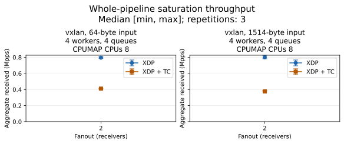

# XDP and TC benchmark results

These measurements cover the generator, veth forwarding, and receiver XDP programs on one host.
The XDP/TC ratio compares median aggregate received throughput for that whole pipeline; it does not isolate DUT cost.
Continuous saturation does not establish maximum loss-free capacity.

Recorded: 2026-10-22T01:25:09Z.
Kernel: `7.0.0-38-generic`; CPU: AMD EPYC 7713P 64-Core Processor; hypervisor: KVM.
Completed trials: 12; expected repetitions per point: 3.
CPUMAP targets: 8.
Matrix status: complete.
Raw inputs and executable hashes are in [environment.json](environment.json) and [runs.json](runs.json).

See the [benchmark methodology](../../../benchmarks.md) for the workload and interpretation of these measurements.

[PNG](throughput.png) | [CSV with all receiver rates](summary.csv)

## Whole-pipeline comparison

The ratio divides the XDP median by the TC median for the same configuration.
Error bars show observed minimum and maximum, not confidence intervals.

| Mode | Input bytes | Fanout | Workers/queues | CPUMAP | XDP Mpps | TC Mpps | XDP/TC | Repeats XDP/TC |
| --- | ---: | ---: | --- | --- | ---: | ---: | ---: | --- |
| vxlan | 64 | 2 | 4/4 | on | 0.796 | 0.410 | 1.939 | 3/3 |
| vxlan | 1514 | 2 | 4/4 | on | 0.801 | 0.376 | 2.131 | 3/3 |

## Offered and received traffic

Offered traffic is XDPerf's processed TX count; each receiver counts actual arrivals in its XDP map.
The signed deficit is `1 - aggregate_received_pps / (offered_pps * fanout)`.
Counter lookups are sequential and each rate uses its own sampling interval.
Small positive or negative deficits can result from sampling skew and packets in flight; these values alone do not establish loss or duplication.
Large positive deficits show a delivery shortfall at the observed offered load and must be reported alongside throughput.
Exact frame copies and local UDP delivery are checked separately by the integration and scenario tests.

| Mode | Bytes | Fanout | Workers/queues | CPUMAP | Backend | Offered Mpps median | Received Mpps median [min, max] | Signed deficit % median [min, max] |
| --- | ---: | ---: | --- | --- | --- | ---: | --- | --- |
| vxlan | 64 | 2 | 4/4 | on | tc | 2.076 | 0.410 [0.405, 0.412] | +90.11843 [+89.64353, +90.23269] |
| vxlan | 64 | 2 | 4/4 | on | xdp | 2.056 | 0.796 [0.788, 0.806] | +80.39313 [+80.24721, +81.68970] |
| vxlan | 1514 | 2 | 4/4 | on | tc | 1.451 | 0.376 [0.373, 0.391] | +86.98560 [+86.48296, +87.13472] |
| vxlan | 1514 | 2 | 4/4 | on | xdp | 1.374 | 0.801 [0.782, 0.825] | +70.84704 [+70.76139, +71.38284] |

## Receiver CPU placement

Each CPU set contains the CPUs with positive packet deltas across the receivers in one trial.
The count in parentheses is the number of trials with that set; only receiver counters contribute, and sender counters are excluded.
These counters record receiver execution and do not by themselves identify forwarding CPU placement.

| Mode | Bytes | Fanout | Backend | Active receiver CPU sets (trials) |
| --- | ---: | ---: | --- | --- |
| vxlan | 64 | 2 | tc | `8` (3) |
| vxlan | 64 | 2 | xdp | `8` (3) |
| vxlan | 1514 | 2 | tc | `8` (3) |
| vxlan | 1514 | 2 | xdp | `8` (3) |

## Whole-host CPU activity

Equivalent busy cores are CPU execution seconds divided by the counter-window duration.
One fully busy core corresponds to 1.0; idle, I/O wait, and steal time are excluded from execution time.
These system-wide observations include generation, forwarding, receivers, and unrelated activity; they do not isolate DUT CPU usage.
Softirq and steal columns use the same core-seconds-per-second scale.

| Mode | Bytes | Fanout | Backend | Busy cores median [min, max] | Softirq cores median | Steal cores median |
| --- | ---: | ---: | --- | --- | ---: | ---: |
| vxlan | 64 | 2 | tc | 5.549 [5.521, 5.563] | 2.733 | 0.008 |
| vxlan | 64 | 2 | xdp | 5.554 [5.516, 5.589] | 2.613 | 0.006 |
| vxlan | 1514 | 2 | tc | 5.847 [5.552, 6.035] | 1.940 | 0.034 |
| vxlan | 1514 | 2 | xdp | 5.590 [5.556, 5.614] | 1.856 | 0.034 |

Before the matrix, the 2.000-second idle baseline averaged 0.815 busy cores across the host.
This baseline is recorded for context and is not subtracted from trial measurements.

## Sampling and host activity

Per-map measurement intervals range from 5.061589 to 5.070360 seconds.
Reading all maps takes 0.093 to 0.251 ms per snapshot.
The perf event duration ranges from 5.033050 to 5.040040 seconds.
Perf and map measurement windows differ; raw records preserve both intervals.
System-wide perf and /proc/stat include generator, forwarding, receivers, and unrelated host activity.
These counters cannot establish isolated forwarding cycles per packet on a shared host.
Before/after per-CPU packet counters in runs.json show where the source and receivers processed packets.
Veth results do not establish physical NIC throughput, latency, or maximum loss-free capacity.
