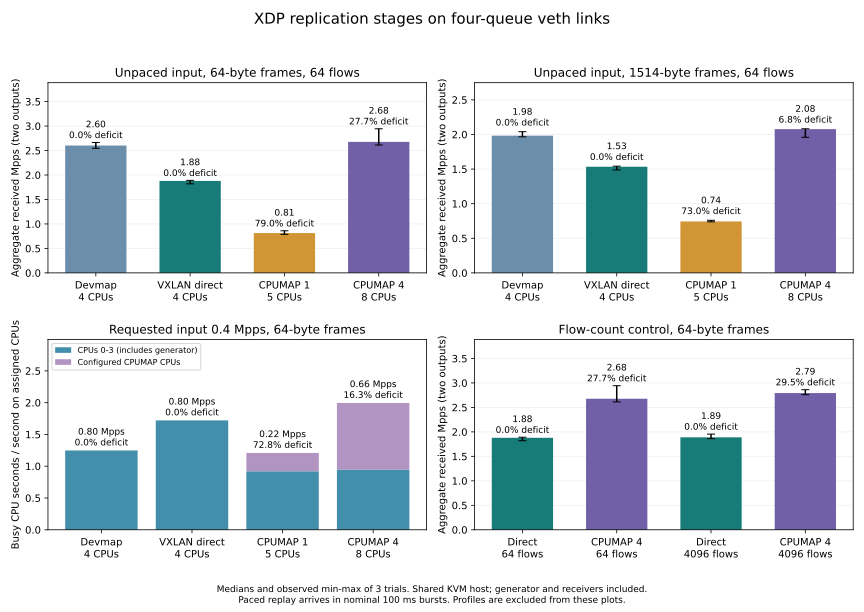

# XDP replication stages

Direct VXLAN forwarding used less CPU per received copy than CPUMAP forwarding in this veth experiment.
It also delivered 2.31 times as many copies as the single-CPU CPUMAP configuration under unpaced input.
Four CPUMAP CPUs increased aggregate throughput over direct forwarding, while requiring four additional CPUs and leaving a substantial delivery deficit.
The comparison includes the generator and receiver processing on a shared KVM host; it does not isolate DUT cost.



Bars show medians of three trials; error bars show the observed minimum and maximum.
Deficit annotations compare received copies with the number expected from the measured offered input.
[PNG](stages.png) / [all summary columns](summary.csv) / [kernel profiles](profile/report.md)

## Unpaced input

The four-CPU CPUMAP configuration increased received throughput by 42% over direct VXLAN for 64-byte frames, while using about 7.79 busy CPUs instead of 4.00.
Direct forwarding received nearly all expected copies at its lower offered input rate.
Moving work to CPUMAP let the generator offer more traffic, but the larger TX rate did not establish successful forwarding.

Each input has two outputs, so received Mpps counts copies, while offered Mpps counts inputs.
Every table column reports its own median; the signed deficit is calculated separately for each trial as `1 - received_pps / (offered_pps * 2)`.
The CPU budget includes the four generator CPUs and any additional forwarding CPUs.

| Input bytes | Stage | CPU budget | Offered Mpps | Received Mpps | Signed sampled deficit % |
| --- | --- | ---: | ---: | ---: | ---: |
| 64 | Plain devmap | 4 | 1.301 | 2.601 | +0.00015 |
| 64 | Direct VXLAN | 4 | 0.940 | 1.879 | +0.00028 |
| 64 | VXLAN, CPUMAP CPU 8 | 5 | 2.009 | 0.814 | +78.99114 |
| 64 | VXLAN, CPUMAP CPUs 8–11 | 8 | 1.996 | 2.677 | +27.74578 |
| 1514 | Plain devmap | 4 | 0.991 | 1.983 | +0.00007 |
| 1514 | Direct VXLAN | 4 | 0.767 | 1.533 | +0.00055 |
| 1514 | VXLAN, CPUMAP CPU 8 | 5 | 1.377 | 0.743 | +73.00692 |
| 1514 | VXLAN, CPUMAP CPUs 8–11 | 8 | 1.103 | 2.077 | +6.77313 |

Plain devmap replicates the original Ethernet frame without VXLAN processing, metadata dispatch, or the header cache.
The difference from direct VXLAN includes all of those operations and the extra output bytes; it cannot isolate encapsulation cost alone.
The [raw saturation trials](saturation/runs.json) retain receiver rates, per-CPU packet counters, link configuration, and whole-host CPU activity.

## Matched requested input rate

At a requested 0.4 million inputs per second, direct VXLAN delivered more copies with less assigned CPU time than the four-CPU CPUMAP configuration.
Measured offered rates were close to the request in every stage.
The single-CPU configuration used fewer busy CPUs at this load, but delivered far fewer copies.

| Stage | Offered Mpps | Received Mpps | Signed deficit % | Busy CPUs on assigned set | CPU seconds per million received copies |
| --- | ---: | ---: | ---: | ---: | ---: |
| Plain devmap | 0.399 | 0.798 | +0.00460 | 1.25 | 1.57 |
| Direct VXLAN | 0.398 | 0.797 | +0.00218 | 1.72 | 2.15 |
| VXLAN, CPUMAP CPU 8 | 0.397 | 0.216 | +72.78741 | 1.21 | 5.31 |
| VXLAN, CPUMAP CPUs 8–11 | 0.397 | 0.665 | +16.27424 | 1.99 | 3.03 |

Busy CPUs means CPU execution seconds divided by the sample duration on CPUs 0–3 and the configured forwarding targets.
It includes generation, receiver work, and unrelated activity on those CPUs; idle, I/O wait, and steal time are excluded.
CPU seconds per million received copies is calculated per trial before taking its median.
It includes work spent on inputs that fail to reach a receiver.

XDPerf's finite rate limiter replays bursts at a nominal 100 ms interval.
At 0.4 Mpps, each of four workers can replay 10,000 frames per interval, while each CPUMAP queue holds 2048 frames.
The instantaneous arrival rate can therefore overflow a queue even when average input is below throughput observed under another arrival pattern.
These are observations for this burst pattern; they do not establish behavior under smoothly paced traffic or maximum loss-free capacity.
The [supplemental trace](profile/report.md#supplemental-controls) directly recorded enqueue drops at this requested rate.
See the [raw paced trials](paced/runs.json).

## Flow-count control

Increasing the workload from 64 to 4096 flows balanced the configured hash buckets, but did not remove the throughput limit.
For 64 flows, the four target CPUs receive 24, 15, 16, and 9 flows respectively.
For 4096 flows, those counts are 1036, 1035, 995, and 1030.
The input source ports range from 10000 through 10063 or 14095, with the same VNI and destination tuple.

| Configuration, 64-byte input | Flows | Received Mpps median [min, max] | Signed deficit % median |
| --- | ---: | --- | ---: |
| Direct VXLAN | 64 | 1.879 [1.819, 1.890] | +0.00028 |
| Direct VXLAN | 4096 | 1.888 [1.862, 1.955] | +0.00049 |
| VXLAN, CPUMAP CPUs 8–11 | 64 | 2.677 [2.612, 2.944] | +27.74578 |
| VXLAN, CPUMAP CPUs 8–11 | 4096 | 2.793 [2.760, 2.862] | +29.48783 |

The observed throughput ranges overlap, and the 4096-flow controls ran in separate blocks after the stage matrices.
The small median change does not isolate the effect of balancing.
It does show that increasing flow count alone did not eliminate the delivery deficit in this setup.
See the [direct control](flows-4096-direct/runs.json) and [four-CPU control](flows-4096-four/runs.json).

## Profiles and implementation implications

The [separate kernel profiles](profile/report.md) recorded CPUMAP enqueue drops and CPU samples in map lookup, LRU update, devmap forwarding, and veth processing.
The four-CPU XDP trace recorded no enqueue drops on CPU 11 while dropping heavily on CPU 8, matching the 64-flow imbalance.
The call chains also show the header-cache update acquiring a hash bucket lock for each input.
Skipping an update when a valid cached template already exists is a candidate for a separate implementation change and measurement.

CPUMAP remains optional and disabled by default.
The four-queue source already distributes direct forwarding work across CPUs 0–3 in this experiment.
Adding a CPU handoff increases available CPU resources and introduces a queue; its value depends on the workload and the goal of that handoff.
The measurements favor keeping direct forwarding as the default for this workload.

## Reproduction and scope

All phases use the same forwarding binary, XDPerf executable, plugin, and counter reader; their SHA-256 hashes are recorded in each phase's `environment.json`.
All ordinary throughput phases use the same comparison runner; the two interleaved stage matrices also share the same stage driver.
Profile phases record their own runner hashes and packet configurations.
Profiles contain tracing and sampling overhead and are excluded from the throughput summaries.

The host has 32 vCPUs, an AMD EPYC 7713P CPU, and Linux `7.0.0-38-generic` under KVM.
Each trial uses four sender workers on CPUs 0–3, four RX/TX queues on every veth endpoint, MTU 1600, and two output namespaces.
The runner disables and verifies segmentation, receive aggregation, and checksum offloads on both ends of every link.
VXLAN adds 50 bytes to each output; Ethernet input sizes exclude FCS, preamble, and interpacket gap.
Local delivery is disabled.

The saturation matrix has 24 trials, the paced matrix has 12, and the two flow-count controls have three each.
Each has a two-second warmup and a five-second sample request.
Stage order is shuffled within each repetition; the separate flow-count controls run direct first, then CPUMAP.
There are also six initial profile trials and two supplemental diagnostic trials, each with a ten-second sampling request.

Run from the repository root, replacing the executable and plugin paths:

```shell
sudo python3 tests/benchmarks/stages.py --xdperf /path/to/xdperf --plugins /path/to/plugins \
  --output /path/to/stages/saturation --phase saturation
sudo python3 tests/benchmarks/stages.py --xdperf /path/to/xdperf --plugins /path/to/plugins \
  --output /path/to/stages/paced --phase paced --pps 400000
sudo python3 tests/benchmarks/compare.py --xdperf /path/to/xdperf --plugins /path/to/plugins \
  --output /path/to/stages/flows-4096-direct --modes vxlan --frames 64 --fanouts 2 --backends xdp --flows 4096
sudo python3 tests/benchmarks/compare.py --xdperf /path/to/xdperf --plugins /path/to/plugins \
  --output /path/to/stages/flows-4096-four --modes vxlan --frames 64 --fanouts 2 --backends xdp --flows 4096 \
  --cpu-redirect --forward-cpus 8,9,10,11
sudo python3 tests/benchmarks/stages.py --xdperf /path/to/xdperf --plugins /path/to/plugins \
  --output /path/to/stages/profile --phase profile
python3 tests/benchmarks/stage_report.py /path/to/stages
```

Report generation requires Matplotlib.
The [tool versions](tools.json) and [validation record](validation.json) retain the plotting environment, binary hashes, and completed trial counts.
Validation checked all 300 endpoint records and found no generator/receiver error counters, lost profile samples, or namespace cleanup errors.
The [benchmark guide](../../benchmarks.md) explains counter windows and the limits of shared-host measurements.
The [earlier flow-hash comparison](../2026-10-22-flow-hash/README.md) includes ordinary TC throughput trials using the same forwarding binary.
These veth results do not establish physical NIC performance, latency, isolated forwarding cycles per packet, or maximum loss-free capacity.
