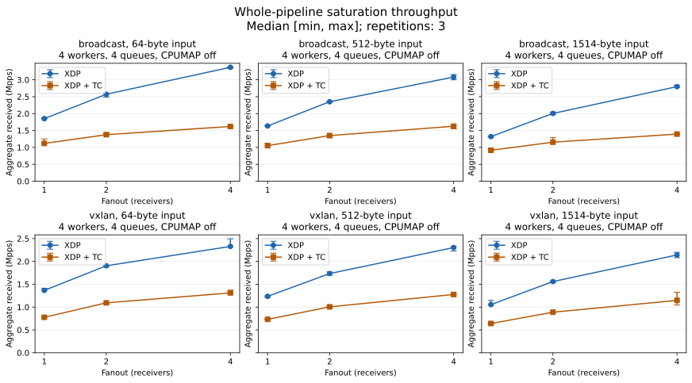

# XDP and TC replication over multiqueue veth

These records predate flow-based CPUMAP selection and the flow-derived outer UDP source port.
The [flow-hash experiments](../2026-10-22-flow-hash/README.md) compare the updated implementation with one and four forwarding CPUs.

This experiment compares native XDP devmap replication with the optional XDP-to-TC backend on the same host.
The two backends use the same forwarding configuration, packet sizes, output destinations, and queue settings.
See the [backend guide](../../tc.md) for the implementation and the [benchmark methodology](../../benchmarks.md) for reproduction commands and counter definitions.

The measurements cover generation, forwarding, and receiver XDP programs together.
The experiment ran on 2026-10-22 in Japan Standard Time, using a shared KVM host with 32 vCPUs, an AMD EPYC 7713P CPU, and Linux `7.0.0-38-generic`.
The raw records use UTC timestamps.
They describe this veth software pipeline; they do not isolate forwarding cost or establish physical NIC throughput, latency, or maximum loss-free capacity.

## Main results

The XDP median aggregate received rate exceeded the TC median in all 18 main configurations, with ratios from 1.443 to 2.080.
For 64-byte input frames, two outputs, four workers, and four queues, the medians were:

| Mode | XDP offered Mpps | XDP received Mpps | TC offered Mpps | TC received Mpps | Received XDP/TC |
| --- | ---: | ---: | ---: | ---: | ---: |
| Broadcast | 1.286 | 2.573 | 0.688 | 1.376 | 1.869 |
| VXLAN unicast replication | 0.952 | 1.905 | 0.547 | 1.093 | 1.742 |

Received throughput sums the two outputs, while offered throughput counts input frames processed by XDPerf.
These ratios compare the complete software pipeline, including generation and reception.
The main matrix's signed sampled deficit ranged from −0.00126% to +0.00181%; sequential reads and packets in flight prevent interpreting these small differences as exact loss or duplication counts.

Points show the median of three trials, with observed minimum and maximum as error bars.
The [main report](main/report.md) lists all configurations, offered rates, individual receivers, sampling durations, and CPU observations.

## Experiments and raw records

Each configuration uses three repetitions with backend order shuffled within each pair.
Each trial has a two-second warmup and a five-second requested sample window.
All links have MTU 1600 and disabled GRO, LRO, GSO, TSO, and checksum offloads.
The receivers count packets in XDP maps without packet capture sockets on the forwarding interfaces.
Local application delivery is disabled during throughput measurement and covered separately by the functional tests.

| Experiment | Input frames | Outputs | Workers / queues | Forwarding CPU | Trials | Results |
| --- | --- | --- | --- | --- | ---: | --- |
| Main matrix | 64, 512, 1514 bytes | 1, 2, 4 | 4 / 4 | Generator CPUs 0–3 and kernel workers | 108 | [Report](main/report.md), [CSV](main/summary.csv), [raw trials](main/runs.json) |
| Single worker and queue | 64 bytes | 2 | 1 / 1 | Generator CPU 0 and kernel workers | 12 | [Report](single-queue/report.md), [CSV](single-queue/summary.csv), [raw trials](single-queue/runs.json) |
| CPUMAP | 64, 1514 bytes | 2 | 4 / 4 | CPU 8 after ingress validation | 12 | [Report](cpumap/report.md), [CSV](cpumap/summary.csv), [raw trials](cpumap/runs.json) |

## Worker and queue counts

Four workers and four queues delivered more copies than the single-worker, single-queue setup for both backends.
The following medians use 64-byte inputs and two outputs; all rates are aggregate received Mpps.

| Mode | XDP: 1 worker / 1 queue | XDP: 4 workers / 4 queues | TC: 1 worker / 1 queue | TC: 4 workers / 4 queues |
| --- | ---: | ---: | ---: | ---: |
| Broadcast | 0.669 | 2.573 | 0.475 | 1.376 |
| VXLAN unicast replication | 0.517 | 1.905 | 0.350 | 1.093 |

Both worker count and queue count changed, so these results show the effect of the combined configuration.
The [single-worker report](single-queue/report.md) includes offered traffic, observed ranges, and CPU counters.

## CPUMAP forwarding

CPUMAP moved receiver processing to CPU 8 and produced a substantial delivery shortfall under this unpaced load.
The generator ran on CPUs 0–3, and the single VNI used CPU 8 with a 2048-frame CPUMAP queue for both backends.
Before/after receiver counters recorded packet processing only on CPU 8; the main matrix recorded it on CPUs 0–3.
The medians for two outputs were:

| Input bytes | Backend | Offered Mpps | Aggregate received Mpps | Signed sampled deficit % |
| --- | --- | ---: | ---: | ---: |
| 64 | XDP | 1.978 | 0.834 | +78.689 |
| 64 | XDP + TC | 2.023 | 0.413 | +90.066 |
| 1514 | XDP | 1.394 | 0.808 | +71.334 |
| 1514 | XDP + TC | 1.423 | 0.378 | +86.708 |

These deficits are much larger than the sampling differences in the main matrix.
The received rates describe operation under overload and do not establish loss-free capacity.
This configuration concentrates forwarding and receiver work on one CPU; adding generator workers does not distribute this VNI's forwarding across those CPUs.
See the [CPUMAP report](cpumap/report.md) for per-receiver rates, observed ranges, CPU activity, and the graph.

## Measurement records

Executable and plugin hashes, kernel and CPU details, CPU affinity, and the idle baseline are recorded in each experiment's `environment.json`.
Each trial directory also retains effective offload and channel settings, the forwarding configuration, generator commands, before/after counters, and system-wide perf data.

The signed sampled deficit compares aggregate receiver rate with offered rate multiplied by fanout.
Sequential map reads and packets in flight can make that value slightly positive or negative.
These saturation trials do not use sequence-based finite packet accounting; the integration and network namespace tests verify exact copies and local UDP delivery separately.
Whole-host CPU counters include unrelated activity and are not DUT-only CPU measurements.
