# Packet replication

With the default `--backend xdp`, the [BPF program](../src/xdp_broadcast.c) uses one `BPF_MAP_TYPE_DEVMAP` for its replication group.
The [Go loader](../pkg/coreelf/broadcast.go) fills its slots with egress interface indices before attaching the program.
For each complete Ethernet frame received on `--device`, the program sends a copy to each `--egress` member except the ingress interface:

```shell
sudo ./bin/goxdp --mode broadcast --device eth0 --egress eth1 --egress eth2
```



[PNG](diagrams/broadcast.png) / [Mermaid source](diagrams/broadcast.mmd)

The forwarding operation is:

```c
return bpf_redirect_map(&tx_ports, 0,
                        BPF_F_BROADCAST | BPF_F_EXCLUDE_INGRESS);
```

`BPF_F_BROADCAST` tells the kernel to replicate to every device in the map, so the map key is ignored.
`BPF_F_EXCLUDE_INGRESS` excludes the receiving interface even if it is a map member.
The [kernel devmap documentation](https://docs.kernel.org/bpf/map_devmap.html) describes using a separate devmap for each multicast group.

This example uses one statically configured group of up to 64 unique interfaces.
Repeat `--device` or `--egress` to add interfaces.
The ingress devices share the same group.
To demonstrate ingress exclusion, include the ingress device in the group:

```shell
sudo ./bin/goxdp --mode broadcast --device eth0 \
  --egress eth0 --egress eth1 --egress eth2
```

The program preserves the frame, including its MAC addresses, IP addresses, and TTL.
Use it with unicast, multicast, or broadcast destination addresses.
`BPF_F_BROADCAST` selects replication behavior regardless of the destination address in the packet.
Group membership is static.
IP multicast routing and IGMP/MLD membership handling require additional logic.
An `XDP_REDIRECT` consumes the received frame; delivery to the host stack requires an explicit output, such as a [local veth](local-delivery.md).
If no eligible egress members remain, no copy is delivered.

You can load the broadcast object without loading the VXLAN or CPUMAP objects.
The loader attaches in native XDP mode and returns an error if the driver cannot support it.
Press Ctrl+C to close the links and release the program and map.
Closing a link detaches the program it owns.
If an attachment fails, the loader also closes the links it has already opened.

Add `--backend tc` to use XDP classification followed by TC cloning with the same group and ingress exclusion.
See the [TC comparison](tc.md) for its packet path and requirements.

Check [building](build.md) for the requirements.
Continue with [VXLAN replication](vxlan.md) to change each output copy, or [local delivery](local-delivery.md) to deliver one copy to an application.
The [Ethernet scenario](testing.md#ethernet-bum) verifies replication and ingress exclusion with live frames.
