# Local application delivery

Add `--local-delivery` to receive a copy in a local application while forwarding the other copies.
Create a veth pair in the same network namespace as `goxdp`, bring both ends up, and assign the application's destination IP to the receiving end:

```shell
sudo ip link add host_tx type veth peer name host_rx
sudo ip link set host_tx up
sudo ip link set host_rx up
sudo ip addr add 192.0.2.99/24 dev host_rx
sudo ./bin/goxdp --mode broadcast --device eth0 \
  --egress eth1 --egress host_tx --local-delivery host_rx
```



[PNG](diagrams/local-delivery.png) / [Mermaid source](diagrams/local-delivery.mmd)

The flag installs the [local receive program](../src/xdp_local.c) on `host_rx` before attaching the forwarding program.
The program sets a unicast destination MAC to `host_rx`'s MAC so that an ordinary IP socket can receive the local copy.
It preserves the source MAC, IP headers, and payload.
Broadcast and multicast MAC addresses are preserved.
With the XDP backend, the receiving veth returns `XDP_PASS`, and the kernel builds an skb for local stack delivery.
The copies sent to the network pass through devmap without an skb on the forwarding host.
The TC backend creates an skb before replication and redirects its local copy to the same receiving veth.
It also attaches a TCX receiver program to clear a retained `PACKET_OTHERHOST` classification after XDP has rewritten the destination MAC.
In a devmap egress program, `XDP_PASS` continues transmission to the selected device; local delivery happens at the receiving veth's ingress program.

Have the application listen on the packet's destination IP and port, or join the multicast group, as it would for normal stack delivery.
Local routing and firewall rules still apply, and the receiving interface is `host_rx` rather than `eth0`.
The flag does not create interfaces, configure addresses, or add the sending peer to a replication group.
Repeat the flag to use separate local receiving interfaces.
Keep each receiver separate from the forwarding interfaces.
The loader detaches its XDP program on shutdown or attachment failure.

The same flag works in VXLAN mode, including with `--cpu-redirect`, and with either `--backend xdp` or `--backend tc`.
The [TC backend](tc.md) sends its local copy through the same veth pair.
Configure `host_tx` as an access port for the desired VNI and include it in that VNI's group, then pass `--local-delivery host_rx`.
The local copy remains an inner Ethernet frame; tunnel copies are encapsulated as usual.
The forwarding rules still apply.
A known local unicast goes only to its FDB destination; BUM traffic goes to the replication group.
FIB mode does not support this option.

See [VXLAN configuration](vxlan.md) for access ports and VNI groups.
The [local delivery scenario](testing.md#local-delivery) checks ordinary UDP socket reception alongside remote forwarding.
