# Comparing XDP and TC replication

Use `--backend tc` to keep native XDP classification and decapsulation while moving replication and VXLAN encapsulation to TC ingress.
The default, `--backend xdp`, uses devmap broadcast and devmap egress programs.
Both backends accept the same broadcast arguments and VXLAN JSON configuration:

```shell
sudo ./bin/goxdp --mode broadcast --backend tc \
  --device eth0 --egress eth0 --egress eth1 --egress eth2
sudo ./bin/goxdp --mode vxlan --backend tc --config examples/vxlan-unicast.json
```

The TC backend supports multicast and unicast VXLAN underlays, static local FDB entries, and ingress exclusion.
FIB mode supports only the XDP backend.
Switch backends by stopping the process and starting it with the other value.

## Packet processing



[PNG](diagrams/backend-comparison.png) / [Mermaid source](diagrams/backend-comparison.mmd)

The diagram shows VXLAN tunnel outputs.
Access outputs keep the inner frame, and CPUMAP is bypassed when CPU redirect is disabled.

For broadcast, XDP checks that the frame contains an Ethernet header, writes the 32-byte command into metadata, and returns `XDP_PASS`.
The kernel creates an skb, and TC reads the command through `data_meta`.
This handoff uses the kernel's [custom XDP metadata support](https://docs.kernel.org/networking/xdp-rx-metadata.html#xdp-pass).
TC restores an 802.1Q or 802.1ad tag from skb metadata when the receive stack has removed it from the frame.
It then walks the configured outputs, excludes ingress, and forwards the frame unchanged.

For VXLAN, both backends compile the same ingress parser.
XDP validates and decapsulates tunnel traffic before handing an inner Ethernet frame to the selected forwarding backend.
TC performs the FDB lookup and sends access copies first.
For traffic arriving from a tunnel, processing ends after access delivery to enforce split horizon.
A known local unicast also goes only to its configured access destination.

For an access BUM frame, TC builds one outer-header template and adds 50 bytes of headroom once, after sending the access copies.
It rewrites the outer source and destination addresses for each eligible tunnel output, recomputes the IPv4 checksum, and sends that copy.
All tunnel copies carry the same inner frame.
The implementation shares the peer-cache lookup and header builder with the XDP backend.
Both backends carry the ingress flow hash in metadata and use it for CPUMAP selection and the outer UDP source port.
TC fills the flow-specific source port after caching the shared template, then retains that port across the tunnel copies.

TC broadcast checks each output's current device MTU, including the same four-byte VLAN allowance used by devmap forwarding.
TC VXLAN also checks the inner frame against the current device MTU before choosing an output, even when the skb already carries an outer header for a previous copy.
Access copies use the current device MTU in both backends, including devmap's four-byte VLAN allowance.
Both VXLAN backends separately apply the port MTUs recorded at load time to encapsulated packets.
Reload after changing tunnel interface MTUs to refresh those recorded values.
An output that fails an MTU check does not prevent delivery to the other eligible outputs.

For N eligible outputs, TC uses `bpf_clone_redirect` for the first N−1 and `bpf_redirect` for the last.
The last output receives the original skb.
No eligible output means a drop, and the forwarding program consumes handled packets before normal IP stack delivery.
The [TC broadcast source](../src/tc_broadcast.c) and [TC VXLAN source](../src/tc_vxlan.c) use bounded `bpf_loop` callbacks to keep verifier complexity independent of the number of members.

`--cpu-redirect` also works with TC in VXLAN mode:

```shell
sudo ./bin/goxdp --mode vxlan --backend tc \
  --config examples/vxlan-unicast.json --cpu-redirect --cpu 0
```

The selected CPU must be available to the process.
The same CPUMAP dispatcher and CPU selection apply to both backends.
In TC mode, the CPU handler returns `XDP_PASS` with the command intact, and TC performs forwarding after skb creation.
The `cpu_packets` counter records CPU-handler executions; `header_preparations` records one template preparation per access BUM input.

`--local-delivery host_rx` uses the same local veth pair with either backend.
Add `host_tx` as an output or access member and keep `host_rx` separate from forwarding ports.
The local receive XDP program adjusts unicast destination MAC addresses and passes the packet to the local stack.
In TC mode, a TCX program on the receiver also changes a retained `PACKET_OTHERHOST` classification to `PACKET_HOST` when the rewritten destination matches the receiver MAC.
This is needed because veth can reuse an skb classified before the XDP rewrite.
See [local application delivery](local-delivery.md) for the interface and address setup.

## Requirements and attachment lifetime

TC mode requires Linux 6.6 or later with TCX support, plus native XDP and custom metadata support on ingress.
TCX provides an owned BPF link for a TC ingress program; its attach type is defined in the [Linux 6.6 UAPI](https://github.com/torvalds/linux/blob/v6.6/include/uapi/linux/bpf.h).
The loader attaches all TCX ingress links before attaching the forwarding XDP programs.
On shutdown or an attachment error, it closes forwarding XDP links first, then forwarding TCX links, then local receiver links.
On a local receiver, TCX attaches before XDP and detaches after XDP.
It creates no qdisc and closes only the links it owns.

Packets without a command return `TCX_NEXT`, allowing later TCX programs and normal ingress processing to run.
Malformed commands are dropped.
Existing earlier TCX programs can still consume packets before this program runs, so use interfaces without other TC handlers for a backend comparison.
TCX links are separate from legacy TC filters: `tc filter show` alone cannot establish that an interface has no TCX program.
The scenario tests query both TCX ingress and egress attachments through the BPF API.

## Forwarding state

`VXLAN.UpdateMembers(vni, devices)` replaces the selected backend's membership state without reattaching programs.
The XDP backend replaces the VNI's devmap in `vni_groups`.
The TC backend replaces one `tc_groups` hash entry containing a count and up to 64 interface indices.
Editing a devmap does not change TC membership.
Both backends use the same configured peers, port properties, FDB entries, and peer-cache revision updates through `VXLAN.UpdatePeer`.
Live membership updates can select subsets of the initially configured group and restore removed members.
VLAN bindings and static tunnel admission remain configured until reload; both backends share the [VLAN egress checks](vlan-bum.md).

Broadcast TC membership uses an array of interface indices and a fixed count supplied by the loader.
Restart the broadcast example to change its group.

## Scope of the comparison

TC encapsulation operates on raw Ethernet bytes and retains the inner skb protocol and header metadata.
It does not configure tunnel checksum or segmentation offload state, and it drops tunnel packets with a nonzero GSO size.
Use complete packets with GRO, LRO, GSO, and TSO disabled, and keep checksum-offload settings equal between runs.
The live tests verify exact encapsulated ARP, IPv4, IPv6, and tagged inner Ethernet frames on veth pairs.

Packet capture on the forwarding host observes the two paths differently.
An `AF_PACKET` tap can receive an skb before TC ingress consumes it, while a frame redirected entirely in native XDP never reaches that tap.
A packet visible to a capture socket therefore does not establish that an ordinary UDP socket received a local copy.
The local delivery scenarios check UDP sockets with local delivery enabled and disabled.
Keep capture sockets off the forwarding host during throughput measurements because they add work to the TC path.

Compare equal input traffic, output counts, interface MTUs, CPU placement, queue counts, and local delivery settings.
For VXLAN unicast replication, use at least two distinct outer destinations and verify the inner bytes at both receivers.
Measure delivered copies and losses at the receivers, including each individual output; a successful helper call or generator submission does not prove delivery.
Report input packets per second separately from aggregate output packets per second, which increases with fan-out.
CPU measurements need to include softirq and CPUMAP workers rather than only the Go loader process.
Record the CPU partition for the generator, forwarding workers, and receivers, along with background traffic and CPU load.
On a shared host, other processes can affect throughput and aggregate CPU counters even when the test processes are pinned; an idle baseline and repeated runs help identify that interference.
Veth measurements characterize this software topology; physical NIC throughput requires a separate experiment.

See [testing](testing.md) for the 196 forwarding scenarios and the additional wire-format checks.
The [benchmark guide](benchmarks.md) provides XDPerf commands for multiqueue veth pairs, and the [recorded experiments](benchmarks/2026-10-22-flow-hash/README.md) include received throughput, observed ranges, and CPU placement.
