# Testing

## Unit and kernel integration tests

Run the CLI validation, devmap configuration validation, and object parsing tests without root:

```shell
make test
```

Run the kernel integration tests with root privileges and network namespace support:

```shell
make test-integration
```

The target selects the separately generated FIB lookup mock object with the `integration` build tag.
It runs each test binary through `sudo unshare --net` in an isolated network namespace.
The broadcast test sends a real Ethernet frame through three veth pairs and checks that the two egress peers each receive one unchanged copy while the ingress peer receives none.
The peers run `XDP_PASS` programs because veth XDP transmit requires XDP on the receiving peer.
The XDP tests install no TC programs.
The additional [TC tests](../pkg/coreelf/tc_integration_test.go) install TCX ingress links and compare complete ARP, IPv4, and IPv6 frames, including distinct VXLAN outer destinations and identical inner frames.
Tagged inner frames also exercise restoration of VLAN bytes from skb metadata.
They also check output-specific MTU and missing-peer suppression, split horizon, FDB membership removal, and continuation to later TCX programs for unrelated traffic.
Access MTU tests compare both backends at the frame-size boundary with untagged, 802.1Q, and 802.1ad frames, including an MTU increase after loading the programs.
The full integration suite requires Linux 6.6 or later for TCX.
The CPUMAP live-frame test additionally requires Linux 5.18 or later.
The [flow tests](../pkg/coreelf/flow_integration_test.go) check TCP/UDP hash stability for IPv4 and IPv6, VNI separation, VLAN priority handling, fragment affinity, and identical hashes before and after decapsulation.
They send repeated flows through sparse CPUMAP CPU IDs, check the per-CPU execution counts, and verify that both tunnel copies use the metadata-derived UDP source port with unchanged inner bytes.

See [generated objects](build.md#generated-objects) for production and mocked BPF variants.
The production FIB load test separately loads the unmocked ELF to check kernel verifier acceptance.
Its packet forwarding is checked through the mocked FIB integration path; production VXLAN forwarding uses the real binary in the namespace scenarios.

Run both build capabilities with `CPUMAP=1` and `CPUMAP=0`, for example `make test test-integration test-scenario CPUMAP=0`.
The direct-only build skips CPU redirect cases while retaining direct FIB, devmap, VXLAN, TC, and local delivery checks.
Additional variant tests inspect the generated ELFs and selected Go bindings, and verify that disabled builds reject explicit CPU requests.
When running `go test` directly against a direct-only binary, include `nocpumap` alongside `integration` or `scenario` as appropriate.

## Network namespace scenarios

Run the [Ethernet BUM scenario](../tests/scenarios/bum_test.go) and the [VXLAN BUM scenario](../tests/scenarios/vxlan_test.go) with:

```shell
make test-scenario
# If Clang has a versioned name: make test-scenario CLANG=clang-18
```

The target builds the production `goxdp` binary and runs the BUM and local delivery topologies with both `--backend xdp` and `--backend tc`.
The full suite requires Linux 6.6 or later.

## Ethernet BUM

The Ethernet scenario creates five network namespaces connected by veth pairs.
The DUT runs the binary in broadcast mode, with `p0`, `p1`, and `p2` as both ingress devices and replication-group members.
The `outside` endpoint is connected to `p3`, which is outside the replication group.



[PNG](diagrams/ethernet-topology.png) / [Mermaid source](diagrams/ethernet-topology.mmd)

Each endpoint and the DUT have their own namespace.
The three group members take turns sending these frames, for 12 scenarios per backend:

| Traffic | Destination MAC | Payload |
| --- | --- | --- |
| Broadcast | `ff:ff:ff:ff:ff:ff` | ARP request |
| Unknown unicast | `02:ff:ff:ff:ff:01` | IPv4/UDP |
| IPv4 multicast | `01:00:5e:01:02:03` | UDP to `239.1.2.3` |
| IPv6 multicast | `33:33:00:00:00:42` | UDP to `ff02::42` |

Each scenario sends four distinct frames and checks every frame byte for byte.
Each of the other two group members must receive exactly one copy per frame.
The sender and the endpoint outside the group must receive no copies.
For the XDP backend, packet sockets on the DUT also verify that no frame reaches the local stack.
For TC, packet sockets can observe ingress before TC consumes it; the local delivery scenarios separately check ordinary UDP socket delivery.
Receivers use [promiscuous packet sockets](https://man7.org/linux/man-pages/man7/packet.7.html) so that unknown unicast frames can be observed even though their destination MAC is not assigned to an endpoint.

The test checks native XDP attachment and the absence of legacy ingress and egress TC filters on all DUT ports.
It separately queries TCX links, expecting one ingress program per forwarding port in TC mode and none in XDP mode.
It also sends SIGINT to the binary and checks that all owned XDP and TCX links detach.
The test cleans up the namespaces, sockets, peer `XDP_PASS` programs, and subprocess whether it passes or fails.
Verbose output reports the number of received copies for each packet at each capture point.

The Ethernet scenario uses the standalone fan-out program and does not encapsulate frames in VXLAN.

## VXLAN BUM

The VXLAN scenario runs four times per backend: multicast and unicast underlays, each with CPU redirect disabled and enabled.
Each run creates three VTEP namespaces and seven endpoint namespaces, with separate access ports for VNI 100 and VNI 200:



[PNG](diagrams/vxlan-topology.png) / [Mermaid source](diagrams/vxlan-topology.mmd)

Both underlay links are direct veth pairs; the scenario creates no Linux bridge or VXLAN device.
Each VTEP runs the production binary with its own JSON configuration.
Each underlay runs eight BUM cases covering ARP broadcast, unknown unicast, IPv4 multicast, and IPv6 multicast for both VNIs.
Four additional cases per run check a 1514-byte access frame (access MTU1500, underlay MTU1600), known local unicast, tunnel split horizon, and a live group membership change without XDP reattachment.
Together with the 12 Ethernet cases, the four 12-case VXLAN runs cover 60 scenarios per backend.
The tests verify unchanged inner frames, VNI isolation, backend-specific attachment, and detach on shutdown.
Packet sockets also check the absence of host-stack copies in XDP mode; TC local delivery is checked with UDP sockets.
Kernel integration tests separately capture the encapsulated packets and check the outer source/destination addresses, UDP and VXLAN fields, IPv4 checksum, and egress MTU enforcement.
The unicast test explicitly compares the two copies: their outer destination IPs differ, and their inner frames are identical.
The XDP integration test also covers per-CPU cache filling, missing entries, uninitialized CPU values, and peer updates that invalidate cached destinations.
The XDP integration tests check the 32-byte command and its shared header in the per-CPU LRU map.
They delete the template, clear a CPU slot, or insert a mismatched header length between replication and egress, then check that each copy arrives with the correct headers.
They also check one preparation per input before replication, execution on an explicitly selected CPU, and drops for missing CPU/devmap handlers.
They check access-MTU local and tunnel delivery, reject invalid outer IPv4 checksums with and without options, and capture successfully forwarded FIB frames in both direct and CPU modes.

## VLAN BUM

The [VLAN scenario](../tests/scenarios/vlan_test.go) runs two VTEPs and five endpoint namespaces.
One source trunk and one remote trunk carry both VID 10 / VNI 100 and VID 20 / VNI 200 over the same unicast underlay interface.
Separate local ports receive each VLAN, while another port binds VID 10 to an isolated VNI 300.
No Linux bridge or VXLAN device is used.

Each backend and CPU mode runs 16 cases: eight BUM cases, two VNI-scoped FDB cases using the same destination MAC, two reverse-delivery cases, three cases with no recipients, and a live group update.
Packet captures reconstruct VLAN tags reported through socket auxiliary data and compare complete frame bytes, including PCP and DEI.
Together these add 64 forwarding cases in the default build.
The [VLAN integration tests](../pkg/coreelf/vlan_integration_test.go) also check encapsulated bytes, multicast underlay, invalid tags, inner-VID mismatches after decapsulation, unauthorized tunnel/VNI pairs, and tagged MTU boundaries.
See [configuration and scope](vlan-bum.md) for port modes and driver requirements.

## Local delivery

The [local delivery scenario](../tests/scenarios/local_test.go) adds six cases per backend: local delivery enabled and disabled in broadcast mode, VXLAN mode, and VXLAN mode with CPU redirect.
It uses two forwarding namespaces, a source namespace, and a remote application namespace, with the local receiver in the ingress forwarder's own namespace.
The tests send unknown-unicast UDP packets and verify exact payload delivery to ordinary UDP sockets, one local and one remote.
The VXLAN cases exercise encapsulation and decapsulation between the two forwarders.
They also check native XDP and the expected TCX attachments, detach on shutdown, and cleanup of all owned links after an ingress attachment failure without disturbing an existing program.

By default, the scenarios cover 196 forwarding cases using veth interfaces, 98 for each backend.
See the [TC comparison](tc.md) for packet capture differences and measurement constraints.
Measure real-NIC behavior and throughput separately.
