# VLAN-scoped BUM replication

VLAN-aware ports classify a tagged frame by its input interface and VID, then use the selected VNI's replication group and FDB.
The XDP and TC backends preserve the complete inner frame, including its VLAN tag, across VXLAN encapsulation and decapsulation.
One trunk can carry several VNIs without merging their flood domains.



[Mermaid source](diagrams/vlan-bum.mmd) / [PNG](diagrams/vlan-bum.png)
The branches represent different input frames; each packet selects exactly one group.
The tunnel interface can be shared between groups.

## Configuration

Use `vlans` on a local port to map VID 10 to VNI 100 and VID 20 to VNI 200:

```json
{"device": "trunk0", "vlans": [{"vid": 10, "vni": 100}, {"vid": 20, "vni": 200}]}
```

Each binding must have a distinct VID in 1..4094 and a distinct VNI in 1..16777215.
A port supports up to 64 bindings and must belong to every bound VNI's configured group.
Choose exactly one local port mode: a fixed `vni` or a nonempty `vlans` list.
Tunnel ports use `local_ip` and cannot specify either local mode.

The [complete configuration](../examples/vxlan-vlan.json) shares two trunks and one tunnel interface between VNI 100 and VNI 200.
Adjust the device names and peer addresses, then run either backend:

```shell
sudo ./bin/goxdp --mode vxlan --config examples/vxlan-vlan.json
sudo ./bin/goxdp --mode vxlan --config examples/vxlan-vlan.json --backend tc
```

Add `--cpu-redirect` to use CPUMAP in an enabled build.
The same configuration also works with `make build CPUMAP=0` using direct forwarding.

## Replication boundary

`BPF_F_BROADCAST` visits entries in the devmap passed to that helper call.
The key is ignored after that map has been selected ([kernel documentation](https://docs.kernel.org/bpf/map_devmap.html#bpf-redirect-map)).
The XDP path selects one VNI's map:

```c
void *members = bpf_map_lookup_elem(&vni_groups, &vni);
if (!members)
    return XDP_DROP;
return bpf_redirect_map(members, 0,
                       BPF_F_BROADCAST | BPF_F_EXCLUDE_INGRESS);
```

The FDB uses `(VNI, destination MAC)`, so a known unicast selects one member of that VNI's devmap.
The TC backend uses a VNI-keyed member list for the same forwarding scope.
The flow hash includes the selected VNI and inner VLAN IDs to select a CPU and an outer UDP source port.
Fixed-VNI access ports retain their existing tag-transparent behavior.

## Ingress classification and admission

On a VLAN-aware local port, ingress requires exactly one inline 802.1Q tag before looking up `(ingress ifindex, VID)` in `vlan_bindings`.
The lookup returns the VNI; an unconfigured VID drops without a fallback.
Because the parser requires a tagged frame, the lookup key needs no separate tag-state field.
One VNI represents one bridge domain in this single-overlay configuration.
Including the interface in the key allows two ports to assign the same VID to different VNIs.

| Incoming binding | Selected VNI | Replication map |
| --- | ---: | --- |
| `trunk0`, tagged VID 10 | 100 | `vni_groups[100]` |
| `trunk0`, tagged VID 20 | 200 | `vni_groups[200]` |
| `trunk9`, tagged VID 10 | 300 | `vni_groups[300]` |
| Unconfigured binding on a VLAN-aware port | None | Drop |

VLAN-aware ports drop untagged frames, truncated tags, priority tags with VID 0, reserved VID 4095, 802.1ad, and double tags.
PCP and DEI do not identify a bridge domain; their bits remain unchanged in the forwarded tag.
Overlay ingress requires `(VNI, tunnel ifindex)` in the static `port_vnis` admission map, in addition to the VXLAN header and destination checks.
A VNI configured on another tunnel port does not authorize reception on this port.
Packets for another outer destination retain the existing pass-to-stack behavior.

After classification, the existing metadata VNI field carries the domain through direct forwarding or CPUMAP.
Classification needs no extension to the 16-byte command header and 16-byte argument union.
Separate overlays reusing the same VNI would need an overlay identity or an independent bridge-domain ID.

## Egress membership and tag handling

VLAN-aware local egress requires `(VNI, egress ifindex)` in `port_vnis` and an inner VID matching that entry's expected VID.
XDP egress and the TC access-copy loop share this check, including after VXLAN decapsulation.
Fixed-VNI access egress retains its `port.vni == packet.vni` check.
The FDB can select different local outputs for the same MAC in different VNIs.

The Go validator requires every VLAN-aware local member of a VNI to use the same VID and rejects a mix of fixed-VNI and VLAN-aware local ports in that VNI.
Configure the same inner VID on the remote VTEP as well, since the tunnel preserves the tag.
For example, a VNI 100 packet carrying an unexpected inner VID 20 cannot escape through a trunk configured for VID 10 in VNI 100.
VNIs containing only fixed-VNI ports keep their tag-transparent behavior.
Access-to-trunk tag insertion or removal, VID translation, and canonical untagged VXLAN inner frames are not implemented.

The loader installs ingress bindings and static admission policies before programs attach.
`UpdateMembers` can remove and restore members of the initially configured group; it rejects additions outside that set.
`UpdatePeer` also requires a preconfigured member of the VNI.
Changing a flood subset does not revoke ingress admission or change VLAN bindings; those remain configured until reload.
Reload to change VLAN bindings or static admission policies, since updates across the classifier, egress policy, and FDB are not atomic.

## Split horizon and multicast membership

VLAN classification retains the leaf-VTEP split horizon.
Local ingress can reach local and tunnel members of its VNI; overlay ingress reaches local members without being flooded back into the overlay.
`BPF_F_EXCLUDE_INGRESS` excludes the receiving interface, while the egress `FROM_TUNNEL` check implements the broader overlay exclusion.
Overlay transit or multihoming would need logical split-horizon groups.

VLAN/BD scoping and IP multicast membership answer different questions.
The first limits the broadcast domain; IGMP/MLD snooping could later choose a subset of that domain for an inner multicast group.
A flat map keyed by `(BD, address family, group[, source])` could select a dedicated receiver devmap, with a policy for unregistered groups.
It would sit alongside the BUM lookup, since map-in-map supports only one level of nesting ([kernel documentation](https://docs.kernel.org/bpf/map_of_maps.html)).
The existing `multicast_ip` config selects the outer VXLAN destination and does not implement inner multicast snooping.

Unicast replication currently allows one peer per `(VNI, egress ifindex)`.
It cannot represent several VTEP destinations on one output device within one VNI.
Devmap keys can be arbitrary, but changing keys to endpoint IDs alone does not make those IDs available to the shared rewrite program.
That extension would need copy-specific endpoint identification.

## Tests and driver requirements

The [kernel integration tests](../pkg/coreelf/vlan_integration_test.go) compare complete inner and outer frames on both backends, with and without CPU redirect.
They check per-VID BUM recipients, the same VID assigned to a different port's VNI, VNI-scoped FDB entries, unicast and multicast underlays, decapsulation, split horizon, invalid tags, unauthorized tunnel/VNI pairs, inner-VID mismatches, tagged MTU boundaries, and live group subsets.
The [configuration tests](../pkg/coreelf/vlan_test.go) reject invalid bindings and incompatible local members.

The [netns scenario](../tests/scenarios/vlan_test.go) runs two VTEPs with a shared trunk and shared underlay for VNI 100 and VNI 200.
It checks VLAN-specific local and remote recipients, reverse delivery, FDB isolation, unconfigured traffic, and a live membership change using the production binary.
It adds 16 forwarding cases per backend and CPU mode, for 64 cases in the default build.
Run it with `make test-scenario`, or select `TestVLANBUM` when invoking the scenario package directly.

An inline parser requires VLAN tags to remain in packet bytes.
The tests use inline tags on veth; real-NIC VLAN offload behavior is untested.
Disable RX VLAN stripping on a physical NIC before using VLAN-aware ports; this example does not recover stripped tags through the [driver metadata API](https://docs.kernel.org/networking/xdp-rx-metadata.html).
A stripped frame reaching a VLAN-aware local port is untagged and drops, since these ports have no untagged binding.
