# VXLAN forwarding

This page describes the default `--backend xdp` path.
The [TC backend](tc.md), selected with `--backend tc`, accepts the same configuration and performs replication and encapsulation in TC after XDP parsing.

This example extends [frame replication](broadcast.md) with VXLAN encapsulation and decapsulation.
It forwards broadcast, unknown unicast, and multicast (BUM) frames within each VXLAN Network Identifier (VNI).

## Configuration

The default mode loads the [VXLAN program](../src/xdp_vxlan.c) using a [JSON configuration](../examples/vxlan.json):

```shell
sudo ./bin/goxdp --mode vxlan --config examples/vxlan.json
```

Before running the example, set the device names, local IPv4 addresses, and unicast peer IP/MAC addresses to match the host.
By default, the loader attaches to all configured ports.
Repeat `--device` to select which of those ports to attach to.
A local port uses a fixed `vni` or a `vlans` list of VID-to-VNI bindings; a port with a `local_ip` is a tunnel port.
Each group supplies a VNI, its member interfaces, and either `multicast_ip` or `unicast_peers`.
The [Go loader](../pkg/coreelf/vxlan.go) records each interface's source MAC and MTU in the port map.

## Per-copy rewriting

XDP prepares a shared Ethernet/IPv4/UDP/VXLAN header in a per-CPU LRU map, carries the VNI, inner length, and flow hash in metadata, then replicates the inner BUM frame to the devmap members.
The frame keeps its inner length until the egress handler runs, because the kernel checks each destination MTU before that handler.
With an IP multicast underlay, the copies use the VNI's multicast destination.
For unicast replication, the devmap egress program handles each output copy independently.
Each tunnel egress handler reconstructs the cache key from the VNI and inner length, copies the prepared header to the packet, and fills its flow-derived UDP source port.
It looks up its own VTEP IP and MAC, then rewrites the outer addresses and IPv4 checksum.
The UDP/VXLAN headers and inner Ethernet frame remain identical in every tunnel copy:



[PNG](diagrams/vxlan-replication.png) / [Mermaid source](diagrams/vxlan-replication.mmd)

The [pipeline documentation](pipeline.md) explains the metadata command, per-CPU caches, and handler dispatch.
BUM selects one VNI's devmap; [VLAN-aware ports](vlan-bum.md) select the VNI by input interface and VID while preserving the inner tag.

The program removes the metadata before transmission; it stays within the local XDP pipeline.
The wire packet carries the standard VXLAN VNI, without adding a field to the inner frame.
Each tunnel copy uses the source IP and MAC of its egress interface, and the IP/MAC destination selected for that VNI and interface.

Use the [unicast configuration example](../examples/vxlan-unicast.json) to assign a remote IP and MAC to each tunnel port:

```shell
sudo ./bin/goxdp --mode vxlan --config examples/vxlan-unicast.json
```

Configure one unicast peer per `(VNI, egress interface)`.
Use distinct egress interfaces for different peers.
The remote MAC must be the VTEP's MAC on a direct link, or the next hop's MAC on a routed link.

## Forwarding rules

An access frame with a broadcast/multicast MAC or an unknown unicast MAC is redirected to its VNI's devmap with `BPF_F_BROADCAST | BPF_F_EXCLUDE_INGRESS`.
Forwarding prepares a shared tunnel header in `header_cache` before broadcast; the devmap egress handler attaches it only to tunnel copies and rewrites their addresses.
Known local unicast and decapsulated traffic keep their inner-frame form throughout forwarding.
A tunnel copy's destination comes from either the multicast configuration or the unicast peer cache.
Use the optional FDB for static local unicast destinations.
The program forwards a frame for a known destination to its access port without flooding it.

On a tunnel port, the program accepts VXLAN packets on UDP port 4789 with the I flag set and a configured VNI.
The destination must be the port's local IPv4 address or the VNI's multicast IP.
The tunnel port must also be a preconfigured member of that VNI.
After validating header lengths and the outer IPv4 checksum, including IPv4 options, the program removes the outer headers and delivers the original inner Ethernet frame to access members of the same VNI.
The split-horizon rule prevents the program from sending a decapsulated frame back to a tunnel.
Unconfigured VNIs and malformed VXLAN headers are dropped; other UDP traffic and fragmented underlay IP traffic pass unchanged to the host stack.

The underlay is IPv4; inner frames may contain ARP, IPv4, IPv6, or other Ethernet protocols.
Encapsulation uses UDP destination port 4789, IPv4 TTL 64, the DF bit, a computed IPv4 checksum, and a zero UDP checksum as permitted by [RFC 7348](https://www.rfc-editor.org/rfc/rfc7348.html).
The UDP source port is `49152 | (flow_hash & 0x3fff)`, using the same inner flow hash as CPUMAP selection.
It remains stable for a flow and supplies entropy for underlay load balancing, following the RFC's recommendation to derive it from inner packet headers.
An encapsulated copy exceeding the configured egress MTU is dropped.
Allow 50 bytes of additional Ethernet frame space, or 36 bytes beyond the inner Ethernet frame when sizing the underlay IP MTU.
Configure underlay multicast routing and IGMP membership in the surrounding network.
This example configures the XDP forwarding maps.

These examples use static VNI and FDB configuration; they do not learn MAC addresses or run a multicast membership protocol.

Use [CPU redirect](pipeline.md#cpu-redirect-and-program-dispatch) to run forwarding on a selected CPU, or [local delivery](local-delivery.md) to receive a copy in a local application.
The [VXLAN scenarios](testing.md#vxlan-bum) verify both underlays, VNI isolation, and split horizon.
